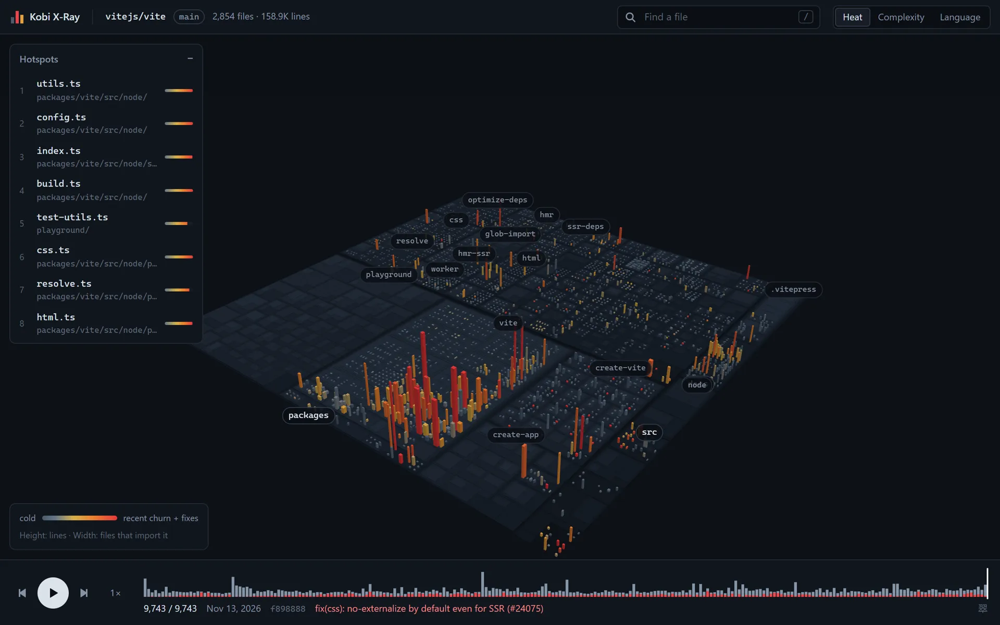
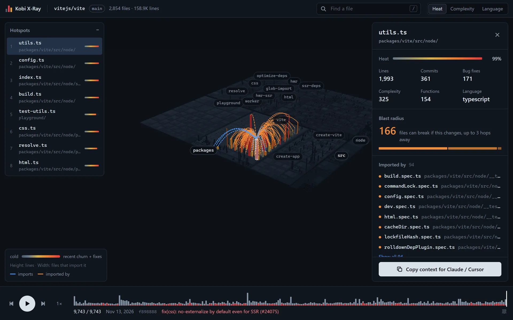

# Kobi X-Ray

[](https://www.npmjs.com/package/kobi-xray)
[](https://github.com/yaakovcarioca/kobi-x-ray/actions/workflows/ci.yml)
[](LICENSE)

Kobi X-Ray renders a Git repository as a navigable 3D city and replays its history commit by commit. It shows where a codebase is large, tightly coupled and unstable, without reading the code.



```bash
npx kobi-xray
```

Run it inside a Git repository and the city opens in your browser. Analysis happens on your machine; no code is uploaded anywhere. Requires Node.js 20 or newer and `git`.

Website: [xray.yaakovcarioca.com](https://xray.yaakovcarioca.com)

## Features

- **City layout.** Every file is a building and every directory is a district.
- **Time travel.** Drag the timeline to replay the repository from its first commit to `HEAD`.
- **Blast radius.** Select a file to see everything that can break, directly or transitively, if it changes.
- **Hotspots.** A ranking of files that combine recent churn, complexity and many dependents.
- **Context export.** Copy a Markdown briefing of a file or module (imports, dependents, blast radius, history) to paste into an AI coding assistant.



## Reading the city

| Visual             | Meaning                                                                            |
| ------------------ | ---------------------------------------------------------------------------------- |
| Building           | One file                                                                           |
| District           | One directory; nested directories stack like terraces                              |
| Height             | Lines of code                                                                      |
| Width              | Fan-in: how many files import it                                                   |
| Colour (heat mode) | Recent churn, with bug-fix commits weighted double; decays with a 90-day half-life |
| Blue / orange arcs | Files the selection imports / files that import the selection                      |

A tall, wide, red building is a large file that many others depend on and that keeps changing.

### Keyboard shortcuts

| Key                       | Action                                             |
| ------------------------- | -------------------------------------------------- |
| <kbd>Space</kbd>          | Play / pause                                       |
| <kbd>←</kbd> <kbd>→</kbd> | Previous / next commit (<kbd>Shift</kbd> jumps 10) |
| <kbd>/</kbd>              | Find a file                                        |
| <kbd>C</kbd>              | Cinematic mode: the camera orbits on its own       |
| <kbd>Esc</kbd>            | Clear the selection                                |

## Usage

```
kobi-xray [dir] [options]

  -p, --port <n>     Port for the local viewer (default 4777)
      --no-open      Do not open the browser
      --no-history   Skip git history (no time travel, no heat)
      --json <file>  Write the snapshot as JSON and exit
  -v, --version      Print the version
  -h, --help         Show this help
```

A snapshot written with `--json` can be opened later by dropping it on the viewer.

## Supported languages

Imports, function counts and cyclomatic complexity come from [tree-sitter](https://tree-sitter.github.io/) grammars compiled to WebAssembly.

| Language                | Import resolution                                                            |
| ----------------------- | ---------------------------------------------------------------------------- |
| TypeScript / JavaScript | Relative paths, `tsconfig` `paths` and `baseUrl`, workspace packages         |
| Python                  | Absolute and relative imports, packages                                      |
| Go                      | Module-local packages via `go.mod`                                           |
| Rust                    | `mod` declarations, `crate::` / `super::` / `self::` paths, workspace crates |

Any other text file still gets a building (height and heat) but has no dependency edges.

## Limitations

- Dependencies are read from the working tree, so while time travelling, arcs and fan-in reflect `HEAD`. Heights and heat are historically accurate.
- Renames are treated as a delete plus an add.
- Only the history of the current branch is read.

## Architecture

```
packages/core   Analysis engine: parsing, import resolution, git mining, layout, replay
packages/cli    The kobi-xray command: analyses a repository and serves the viewer
apps/web        The 3D viewer (React, Three.js, React Three Fiber)
```

## Contributing

Contributions are welcome, from bug reports to new language support. The short version:

```bash
git clone https://github.com/yaakovcarioca/kobi-x-ray.git
cd kobi-x-ray
npm install
npm test
npm run build
node packages/cli/dist/bin.js .
```

Read [CONTRIBUTING.md](CONTRIBUTING.md) for the development workflow, the project layout and how to submit a pull request. For anything larger than a small fix, please open an issue first so we can agree on the approach.

## License

[MIT](LICENSE)
